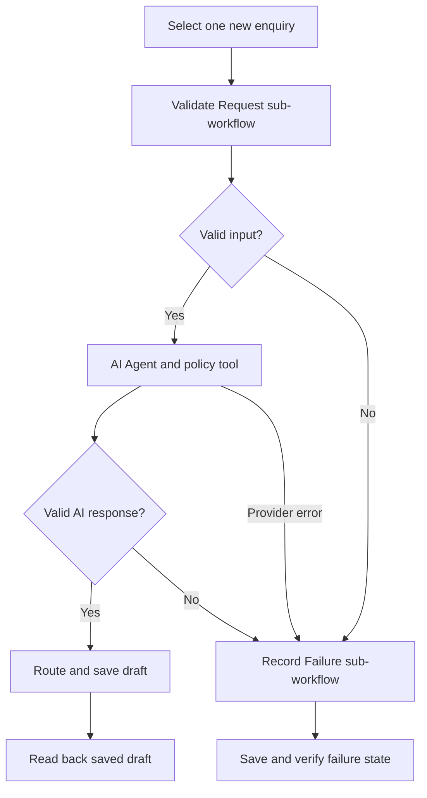

# Sardinia Travel Request Assistant

### Turn a Segment Into a Reusable Block

A practical n8n project for turning manually entered tourism enquiries into structured summaries and multilingual reply drafts. Built around reusable validation and explicit error handling, with human review before any reply is sent.

**Publication status:** the workflows were built locally through a guided implementation. This repository contains the English documentation, node code, prompts, fictional fixtures and deterministic tests. The final n8n workflow JSON exports have not yet been supplied, so one-click workflow import is not available. The empty-message error path was confirmed by the project owner; other integration cases remain explicitly unverified here.

## The problem

Tourism enquiries often arrive as short, incomplete messages: a traveller asks for a boat trip but omits their location, exact date or group size. The assistant helps the adviser clarify the request and prepare an appropriate reply without inventing prices, availability or bookings.

## What it does

1. Reads one selected new enquiry from an n8n Data Table.
2. Normalises and validates it through a reusable sub-workflow.
3. Uses a Gemini-powered AI Agent and a read-only service-policy tool.
4. Validates the AI response and routes the request to a complete-response, clarification or human-review path.
5. Saves the draft and reads the row back to confirm the update.
6. Routes expected and technical failures through a shared failure handler and records safe recovery metadata.

## Architecture



## Skills demonstrated

| Area | Project evidence |
|---|---|
| Practical automation | A tourism use case with structured records and reviewable output |
| Modularisation | A three-node segment extracted behind typed inputs and a stable output contract |
| AI integration | Gemini Chat Model, explicit prompts and a read-only tool |
| Conditional logic | Record selection, validation, response checks and routing |
| Reliability | Error classification, event logging, read-back checks and manual recovery |
| Testing | Executable code checks plus an honestly labelled integration matrix |

## Documentation

- **[Project overview](docs/project-overview.md)** — a concise walkthrough of the work and design decisions.
- [Setup and reconstruction](docs/setup.md)
- [Reusable validation](docs/modularisation.md)
- [Error handling and recovery](docs/error-handling.md)
- [Tests and evidence](docs/testing.md)
- [Assignment alignment](docs/assignment-evidence.md)
- [Privacy and publication](docs/security.md)
- [Workflow export status](workflows/README.md)

## Run the deterministic checks

Requires Node.js with modern JavaScript support; verified here with Node.js v24.22.1. No npm packages, credentials or network requests are required.

```bash
node tests/test-code.mjs
```

These checks exercise the node code independently. They do not prove that n8n connections, credentials or live model calls work.

## Scope and limitations

Manual execution, one request at a time, no overlapping runs. No Instagram/Facebook API integration, automatic sending, payments, booking or live availability. All replies require human review. Gemini receives the submitted text. Model availability and free-tier quotas depend on the account. Processed-row protection does not detect a message pasted into a new row. State updates and error-log writes are not transactional. The output guard checks structure and values, not the truth of every sentence.

Data Tables are the alternative explicitly permitted by the assignment. A second demonstration caller is optional, not required for the working assistant.

## Future extension

A future social connector or Google Sheets adapter can map data into the same validator contract. A verified service catalogue can replace the demo policy tool. The reusable validation logic can remain shared.

## Privacy

Only synthetic fixtures and generic code are published. No API keys, real customer messages, private Italian guide, credential exports, screenshots of account details, database files or runtime logs are included. No open-source licence is selected in this initial publication.
