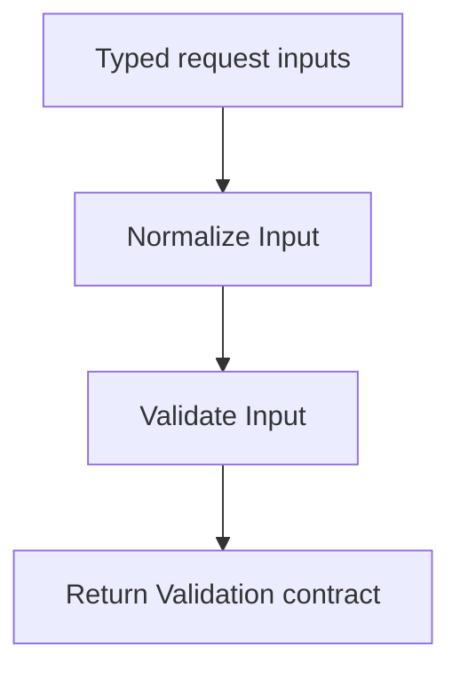

# Project Overview

## Sardinia Travel Request Assistant — Turn a Segment Into a Reusable Block

This project applies workflow modularisation to a practical tourism assistant. It was developed as the “Turn a Segment Into a Reusable Block” n8n exercise and as a foundation for a future Sardinia tourism business.

The aim is simple: paste a traveller's enquiry, obtain a structured interpretation and review a useful response draft. The project runs manually in a self-hosted Docker installation. Google Gemini supplies the language model; n8n Data Tables store requests and results. Social messaging integrations are deferred until the business needs them.

## 1. Input and selection

The adviser adds an enquiry to `travel_requests` with a unique request_id, source, message_text and status=new. A manual Select Request node chooses the request to process. The lookup checks both its code and new status.

Capture Request distinguishes one match, no match and ambiguous matches. A valid selection retains the native Data Table row ID for subsequent updates; the AI does not generate the database identifier. No match ends with an informative notice. Duplicate new request IDs stop the workflow visibly.

## 2. The reusable segment

The original main workflow contained three adjacent Code nodes:

- Normalize Input: trim text fields and standardise the channel name.
- Validate Input: check request ID, supported source, message presence and length, and optional timestamp.
- Return Validation: expose a consistent result containing is_valid, validation_issues and the normalised request.

These nodes were extracted into `Sardinia | Validate Request v1`. Its trigger declares four string inputs: request_id, source, message_text and received_at. The main workflow invokes it through Execute Sub-workflow and waits for completion.

The module has no Gemini calls, Data Table operations or references to parent-node names. This boundary makes it reusable for future forms, social connectors or spreadsheet sources. Invalid customer input is returned as data rather than treated as a code crash. Unexpected execution faults use the caller's error path.

The main workflow then uses is_valid to continue or record a validation failure. Missing travel details are different from invalid input: a well-formed message without an exact travel date can still be processed and lead to clarification questions.

## 3. Claiming the request

Before AI processing, the main workflow updates the selected row to processing, increments the processing-attempt counter and clears stale output. It reads the row back and verifies the native ID and state before proceeding.

This makes progress visible and reduces false-success outcomes. It does not implement an atomic lock: version 1 requires one manual run at a time. An interrupted processing row must be inspected before retrying.

## 4. AI analysis and drafting

The Travel Agent receives the normalised message and a reference timestamp. Its Gemini Chat Model is connected through n8n Credentials. A read-only service_policy tool supplies a small demo policy: boat-trip and local-food enquiries, required details and explicit limits.

The Agent is asked to return a fixed JSON shape containing language, area, date information, group size, service, review flag, summary and draft_reply. Unknown values remain null rather than being invented. The draft uses the customer's language. Prices, availability, partners and confirmed bookings must not be fabricated.

Agent iterations and node retries are bounded. No conversation memory or external sending tool is attached. Using a tool does not prove the model obeyed every policy, so output still requires review.

## 5. Output checks and routing

Validate AI Result parses the response and checks the required keys, types, group size, calendar date and non-empty bounded draft. Invalid output is rejected instead of being accepted silently.

For a valid result, deterministic routing selects:

| Route | Meaning | Adviser action |
|---|---|---|
| ready | Essential travel details are present | Review and reply |
| clarification | Essential details are missing | Review clarification questions |
| human_review | The model flags conflicting, unsupported or special handling | Review the situation before replying |

A valid output shape is not proof of factual accuracy. The adviser checks the extracted facts and every draft. No reply is sent automatically.

## 6. Saving a successful result

The workflow writes the route, next action, analysis JSON, draft and timestamp to the original row, with status=draft_ready. A second read verifies the actual stored status, row ID and draft content. A request already marked draft_ready is not selected again unless the adviser deliberately resets its status.

## 7. Graceful error handling

Failures are prepared as a structured envelope with context, error, stage and optional forced_code. `Sardinia | Record Failure v1` classifies the problem, inserts safe metadata into error_events and returns a recovery result.

Known categories include invalid input, empty or malformed AI output, authentication failures, quota/rate limits, temporary network/provider problems and storage failures. Unrecognised provider shapes remain UNEXPECTED_ERROR rather than receiving an unjustified diagnosis.

The main workflow writes invalid or error to the request and verifies that update. If event logging or the final failure-state write cannot complete, a Stop And Error node leaves a visible failure. The handler does not recursively call itself.

The project uses explicit error outputs and direct sub-workflow calls because its normal execution is manual; it does not rely on Error Trigger to catch manual tests. A green execution can mean a failure was handled successfully, not that a draft was produced.

## 8. Recovery and evidence

The adviser reads error_code and error_message, corrects the cause, then changes status to new for a deliberate retry. retryable is advisory and does not start an automatic loop. Previous events remain in the log.

The owner confirmed the empty-message case, DEMO-004: validation failed as expected and the error path completed. The publication also includes 26 deterministic checks run against the supplied JavaScript. Other live integration and fault-injection cases remain pending explicit confirmation. See testing.md for the evidence boundary.

## 9. Assignment and portfolio value

The project reads structured records using the allowed Data Tables alternative, uses an AI Agent, contains multiple decisions and extracts a reusable segment. Its error handling addresses the bonus through explicit states, logging and recovery, with a confirmed input-error scenario and further documented tests.

The public repository explains the design without including real customer data, credential secrets or the private Italian learning guide. Final locally exported workflow JSON files still need to be supplied, sanitised and import-tested before the repository can offer an importable release.
